# DoaFácil API

API REST feita em C# com .NET 10, Minimal API e Entity Framework Core para controlar pontos de coleta e doações.

## Integrantes

- Nome completo - RM00000
- Nome completo - RM00000
- Nome completo - RM00000

## Contexto

Muitas ONGs e campanhas solidárias (agasalho, alimentos, brinquedos) ainda controlam as doações em caderno ou planilha. Isso dificulta saber o que já chegou, o que está sendo separado e o que já foi entregue.

A DoaFácil é o backend para esse controle. Com ela é possível cadastrar os pontos de coleta (ONGs, igrejas, escolas) e registrar cada doação recebida, acompanhando o status até a entrega. O projeto é voltado para coordenadores e voluntários que organizam arrecadações.

Regras implementadas:

- Não pode ter dois pontos de coleta com o mesmo nome na mesma cidade.
- Ponto de coleta inativo não recebe doações.
- Ponto de coleta com doações não pode ser excluído, só desativado.
- Status da doação: Recebida, EmTriagem, Distribuida ou Cancelada. Só é possível avançar na ordem, e cancelar antes de distribuir.

## Banco de dados

SQLite. O arquivo `doafacil.db` é criado dentro de `src/DoaFacil.Api` quando as migrations são aplicadas. A migration inicial já insere 2 pontos de coleta e 2 doações de exemplo.

## Tecnologias

- .NET 10
- ASP.NET Core Minimal API
- Entity Framework Core 10 (SQLite)
- OpenAPI + Scalar

## Como rodar

Pré-requisitos: .NET SDK 10 e a ferramenta do EF Core:

```bash
dotnet tool install --global dotnet-ef
```

Passos:

```bash
git clone <url-do-repositorio>
cd doafacil-api
dotnet restore
dotnet ef database update --project src/DoaFacil.Api
dotnet run --project src/DoaFacil.Api
```

A API sobe em http://localhost:5066

- Scalar: http://localhost:5066/scalar
- OpenAPI: http://localhost:5066/openapi/v1.json

Para criar uma nova migration:

```bash
dotnet ef migrations add NomeDaMigration --project src/DoaFacil.Api
dotnet ef database update --project src/DoaFacil.Api
```

## Endpoints

### Pontos de coleta

| Método | Rota | Descrição |
|---|---|---|
| GET | /api/pontos-coleta | Lista os pontos (filtros: cidade, ativo) |
| GET | /api/pontos-coleta/{id} | Busca um ponto pelo id |
| GET | /api/pontos-coleta/{id}/doacoes | Lista as doações de um ponto |
| POST | /api/pontos-coleta | Cadastra um ponto |
| PUT | /api/pontos-coleta/{id} | Atualiza um ponto |
| DELETE | /api/pontos-coleta/{id} | Exclui um ponto |

Exemplo de body:

```json
{
  "nome": "Escola Viva",
  "endereco": "Rua A, 10 - Gonzaga",
  "cidade": "Santos",
  "uf": "SP",
  "telefone": "(13) 9999-0000",
  "ativo": true
}
```

### Doações

| Método | Rota | Descrição |
|---|---|---|
| GET | /api/doacoes | Lista as doações (filtros: status, categoria, pontoColetaId) |
| GET | /api/doacoes/{id} | Busca uma doação pelo id |
| POST | /api/doacoes | Registra uma doação |
| PUT | /api/doacoes/{id} | Atualiza uma doação |
| PATCH | /api/doacoes/{id}/status | Altera o status |
| DELETE | /api/doacoes/{id} | Exclui uma doação |

Exemplo de body:

```json
{
  "nomeDoador": "Ana Souza",
  "descricao": "Kits de higiene pessoal",
  "categoria": "Higiene",
  "quantidade": 30,
  "pontoColetaId": 1
}
```

Categorias: Alimento, Roupa, Higiene, Brinquedo, Movel, Outro.

Body do PATCH:

```json
{ "status": "EmTriagem" }
```

Os erros voltam no formato ProblemDetails com o status correspondente (400, 404 ou 409).

## Testes

A coleção do Postman está em `docs/DoaFacil.postman_collection.json`. Também dá para testar pelo Scalar ou pelo arquivo `src/DoaFacil.Api/DoaFacil.Api.http`.

### Prints

GET /api/pontos-coleta
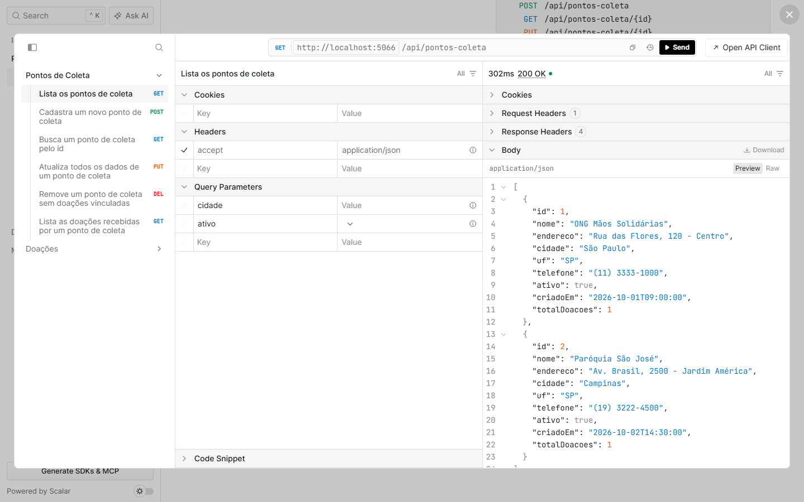

GET /api/pontos-coleta/{id}
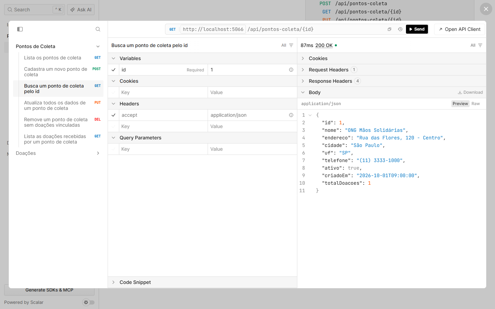

GET /api/pontos-coleta/{id}/doacoes
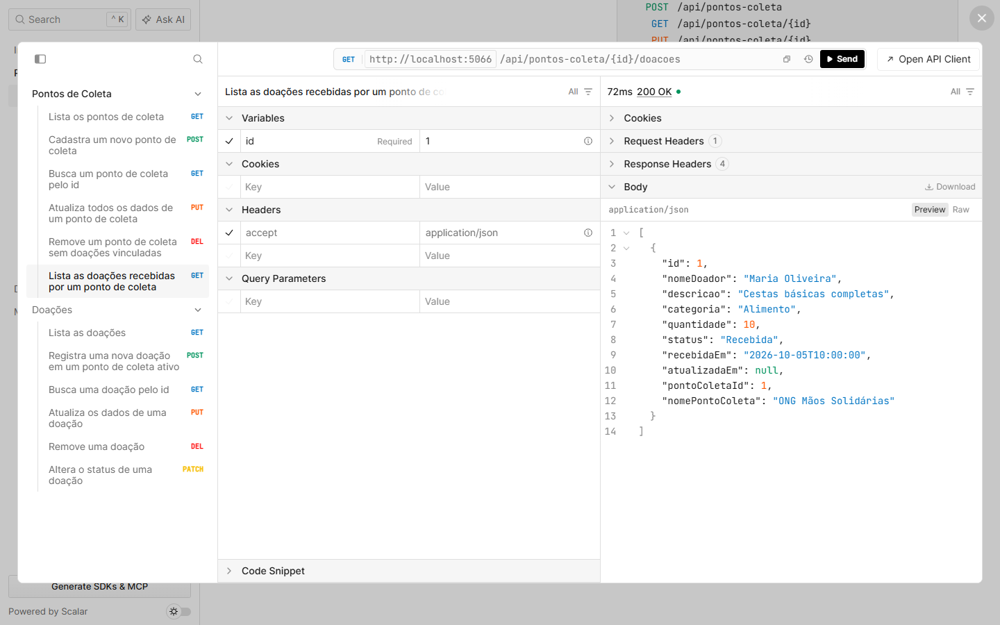

POST /api/pontos-coleta
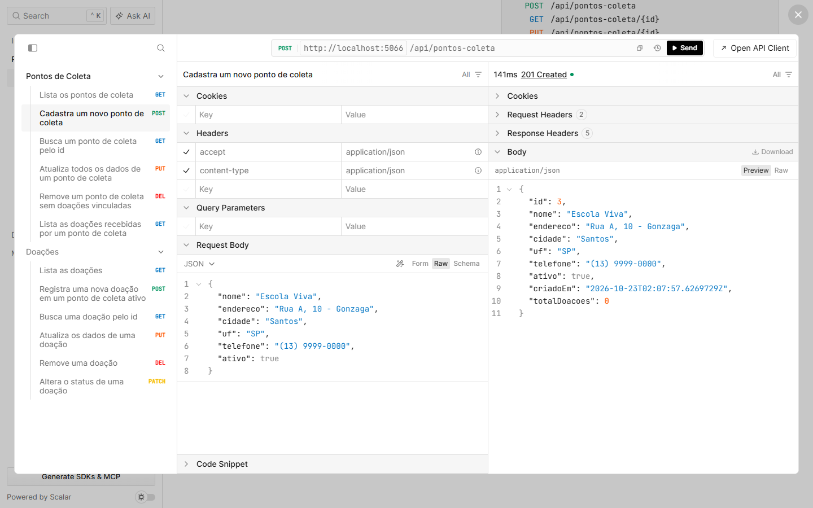

PUT /api/pontos-coleta/{id}
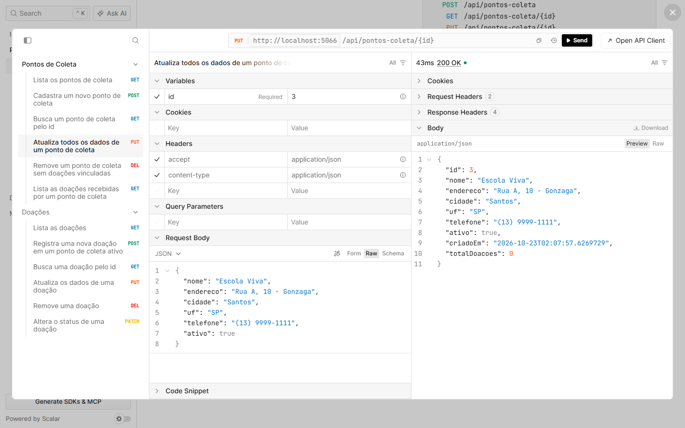

DELETE /api/pontos-coleta/{id}
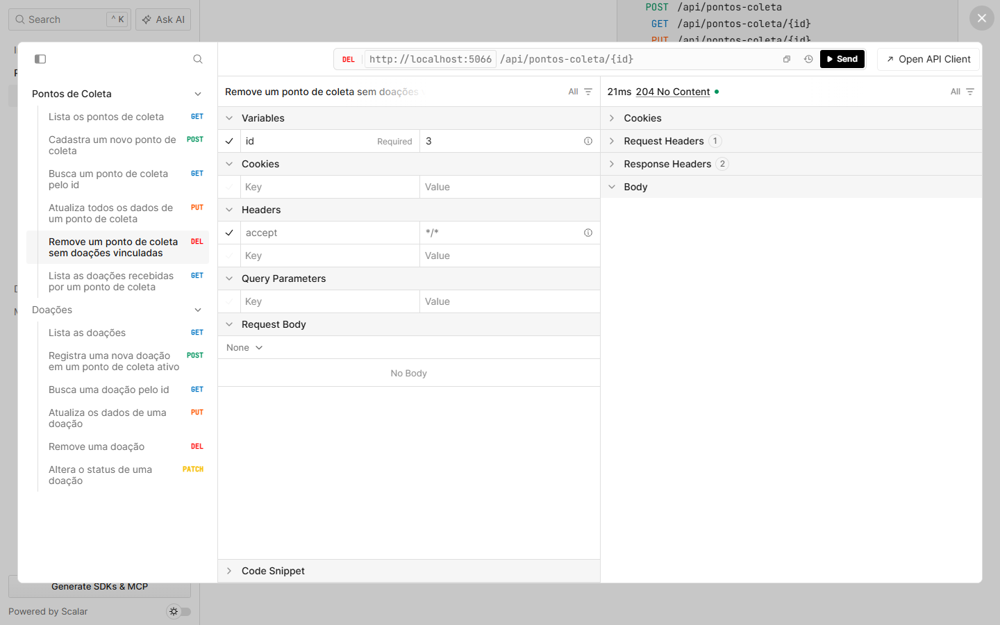

GET /api/doacoes
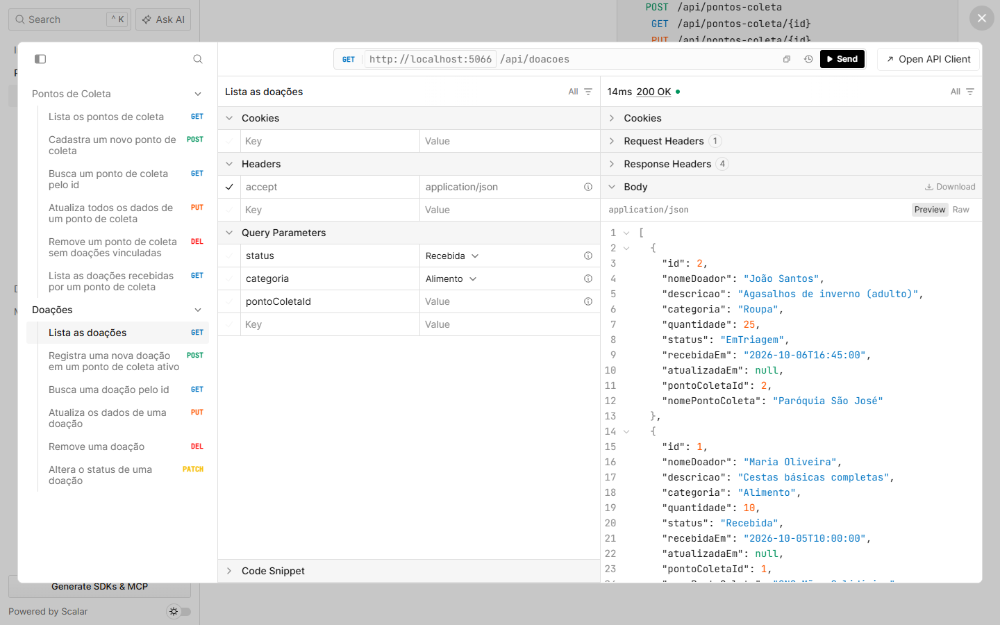

GET /api/doacoes/{id}
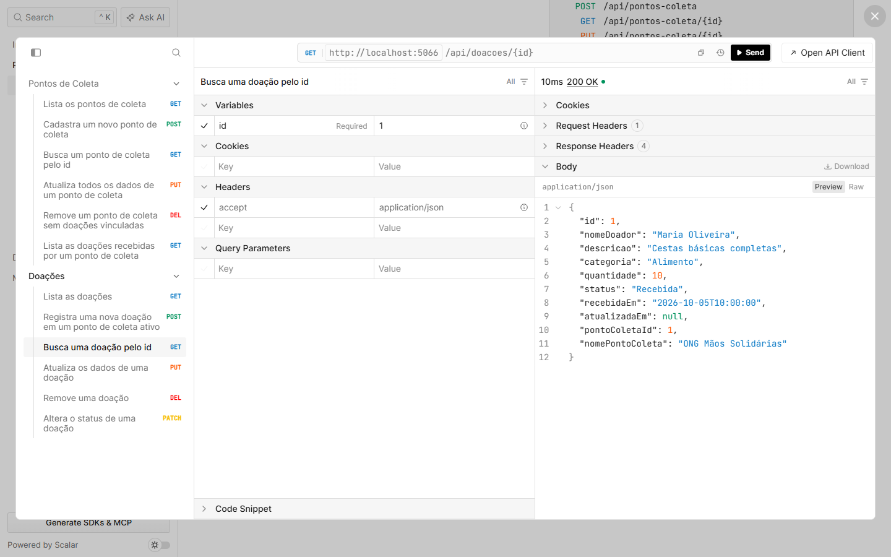

POST /api/doacoes
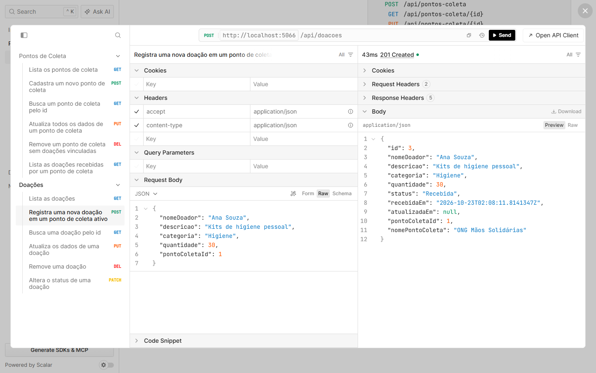

PUT /api/doacoes/{id}
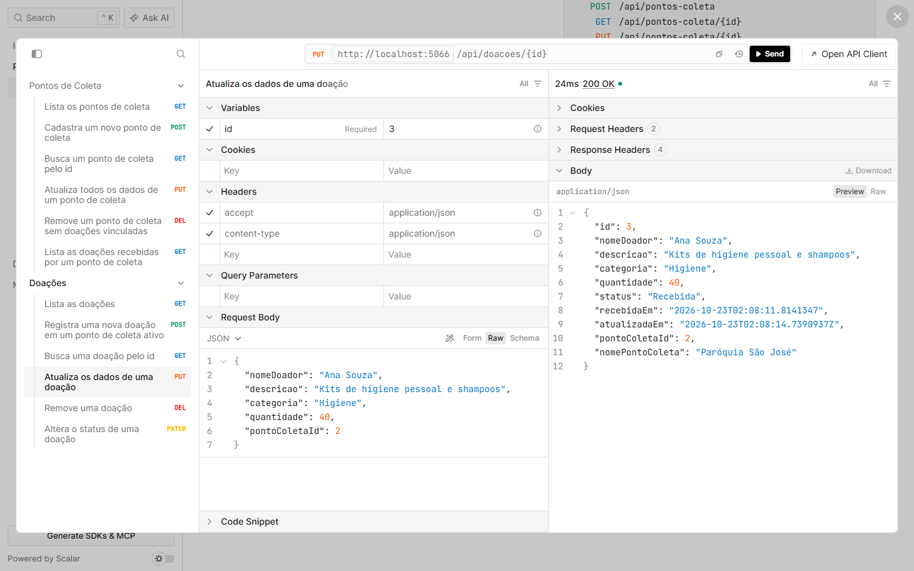

PATCH /api/doacoes/{id}/status
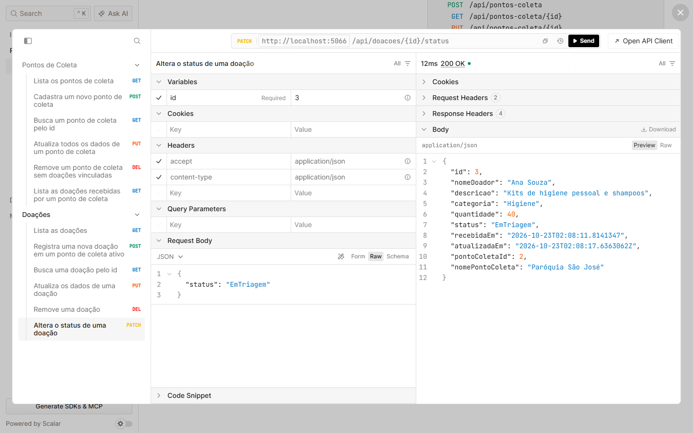

DELETE /api/doacoes/{id}
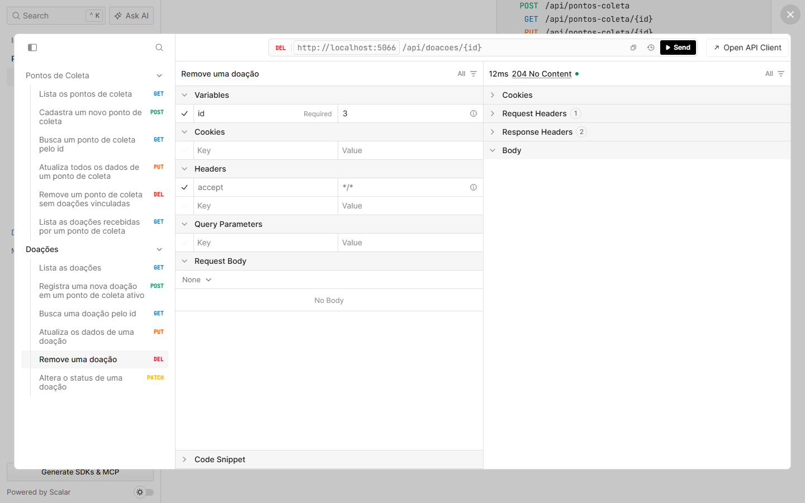

Erro de validação (400)
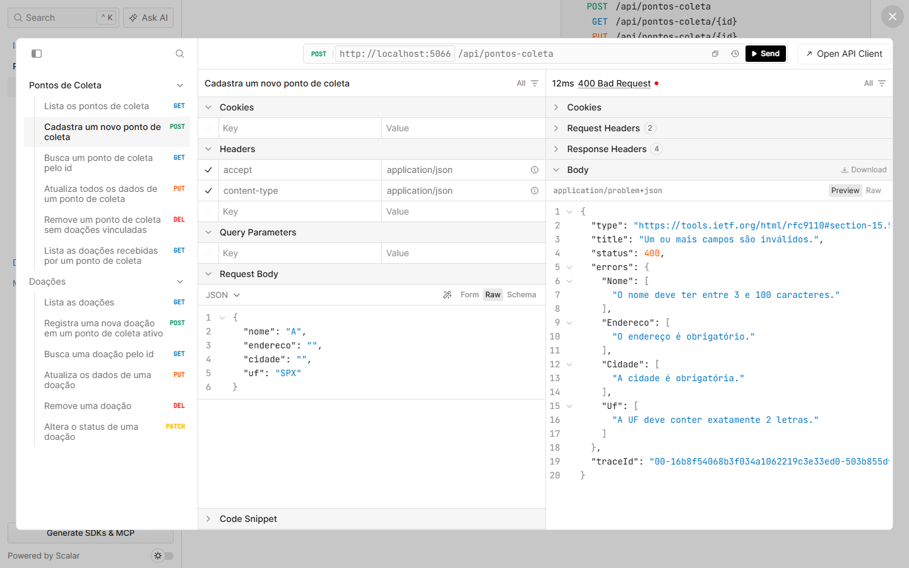

Não encontrado (404)
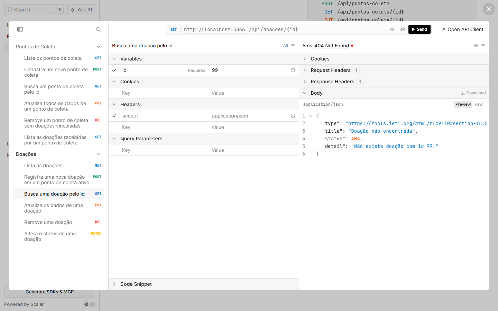
